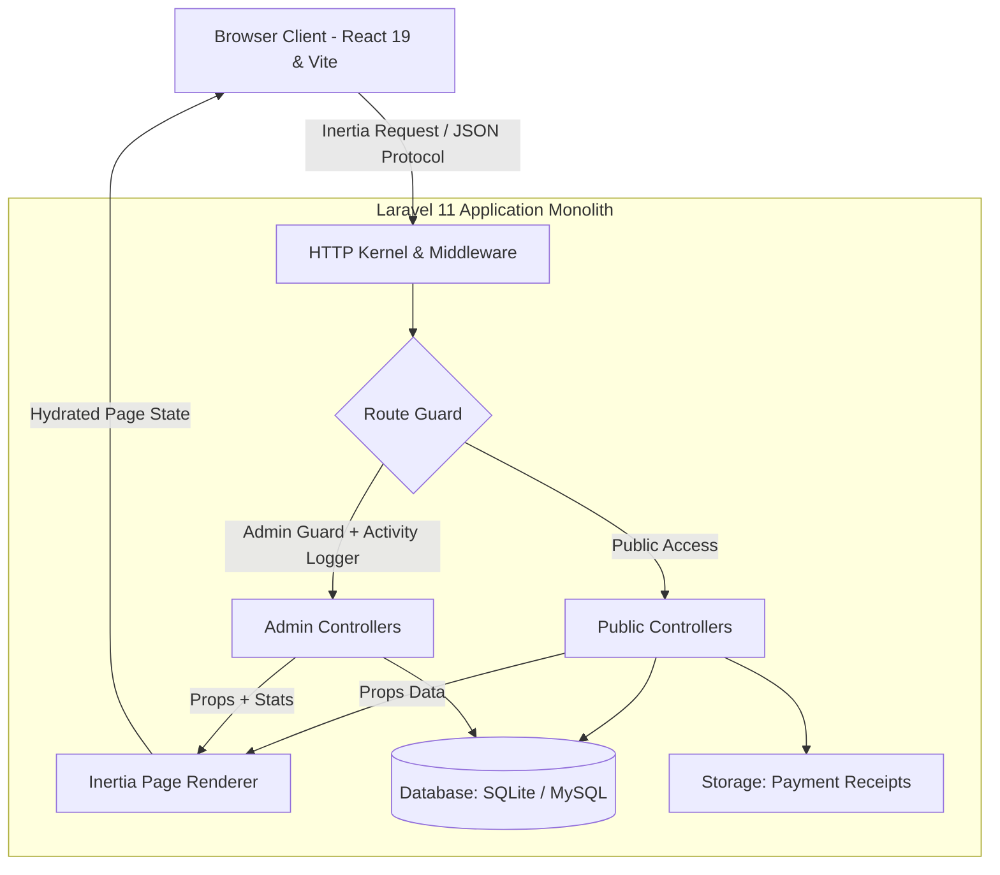
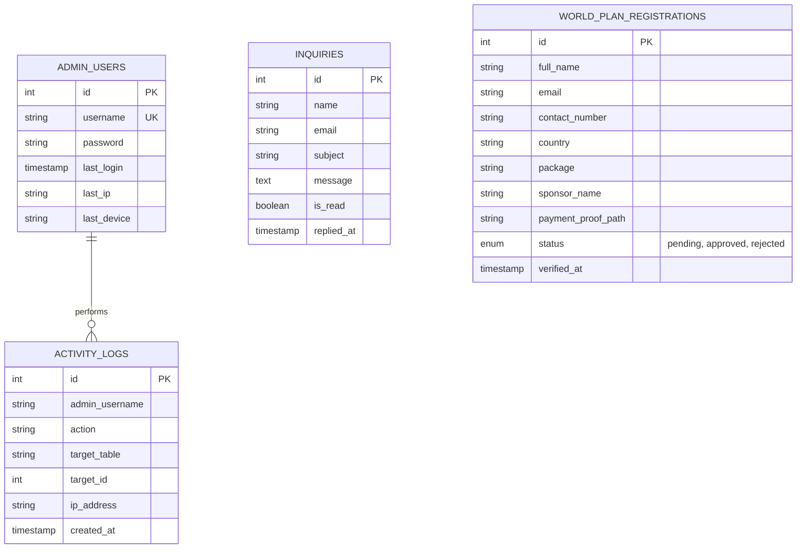

<div align="center">

  

  # ✦ I N F I N I T E ✦
  ### **L I V E &nbsp; L I M I T L E S S**

  <p align="center">
    <strong>Global E-Commerce &bull; Multi-Currency Compensation Engine &bull; Organic Wellness &bull; Luxury Skincare</strong>
  </p>

  <p align="center">
    <a href="#-quick-start"><strong>Quick Start</strong></a> &nbsp;&bull;&nbsp;
    <a href="#-system-architecture"><strong>Architecture</strong></a> &nbsp;&bull;&nbsp;
    <a href="#-core-modules"><strong>Features</strong></a> &nbsp;&bull;&nbsp;
    <a href="#-compensation-engine"><strong>World Plan</strong></a> &nbsp;&bull;&nbsp;
    <a href="#-admin-control-center"><strong>Admin Portal</strong></a> &nbsp;&bull;&nbsp;
    <a href="#-testing-suite"><strong>Testing</strong></a>
  </p>

  <p align="center">
    
    
    
    
    
    
  </p>

  <p align="center">
    
    
    
    
  </p>

</div>

---

> [!NOTE]
> **INFINITE | Live Limitless** is an enterprise-grade digital ecosystem uniting premium wellness distribution, high-luxury French-formulated skincare, and a multi-currency international compensation system. Powered by a unified **Laravel 11 + React 19 Inertia SPA** architecture, it delivers instantaneous client-side navigation with zero REST API latency while preserving 100% visual fidelity to the brand's original aesthetic heritage.

---

## ⚡ At a Glance

<table>
  <tr>
    <td width="50%" valign="top">
      <h3>🌐 Public Ecosystem</h3>
      <ul>
        <li><strong>Dynamic Showcase</strong>: Interactive typewriter hero with a 12-slide product banner carousel and 4 mission pillars.</li>
        <li><strong>Interactive Curation</strong>: Reactive category filtering (<em>All</em>, <em>Wellness</em>, <em>Skincare</em>, <em>O'Lamour</em>) with full ingredient modal previews.</li>
        <li><strong>Infinite Barley</strong>: 3-variant botanical card carousel, metabolic job breakdowns, and clinical anti-aging profiles.</li>
        <li><strong>O'Lamour Skincare</strong>: French luxury formulations, regimen timeline, and interactive clinical FAQ accordion.</li>
        <li><strong>Corporate Transparency</strong>: Executive board, SEC/DTI registrations, and high-resolution BIR compliance documents.</li>
      </ul>
    </td>
    <td width="50%" valign="top">
      <h3>💼 Business & Admin Desk</h3>
      <ul>
        <li><strong>World Plan Compensation</strong>: Dynamic multi-currency engine supporting <strong>USD ($)</strong>, <strong>PHP (₱)</strong>, and <strong>PGK (Kina)</strong>.</li>
        <li><strong>Interactive Calculator</strong>: Real-time distributor earnings simulator for pairing, retail, and unilevel bonuses.</li>
        <li><strong>Payment Proof Processing</strong>: Multipart image uploads with built-in admin lightbox verification.</li>
        <li><strong>Global Footprint</strong>: 11 localized international community gateways with interactive SVG World Map.</li>
        <li><strong>Executive Control Suite</strong>: Metrics dashboard, inquiry reply modal, registration approval desk, and immutable activity logs.</li>
      </ul>
    </td>
  </tr>
</table>

---

## 🏛 System Architecture

The application adopts a **Monolithic Single Page Application (SPA)** paradigm via Inertia.js. Client requests render rich React 19 components directly without redundant JSON API abstractions, serialization overhead, or client-side routing desynchronization.



### 🎨 Scoped Stylesheet Strategy
To eliminate global style contamination across pages, stylesheets are dynamically mounted in each page's `<Head>`:

```
public/assets/css/
  ├── styles.css            # Base design system (loaded globally)
  ├── index.css             # Home page hero, product grid, team carousel
  ├── barley.css            # Barley interactive cards & metabolic tabs
  ├── olamour.css           # Luxury skincare typography & glow effects
  ├── info.css              # Corporate legitimacy tabs & document lightbox
  ├── select-country.css    # Interactive world map & region selector
  ├── join-community.css    # Localized packaging tiers & steps
  └── world-plan.css        # Multi-currency tables & compensation cards
```

---

## 💎 Core Modules

### 1. Public Portals

<details open>
<summary><b>✨ Showcase & Brand Hubs</b></summary>
<br>

| Route | Page Component | Primary Functionalities |
| :--- | :--- | :--- |
| `/` | `Home.jsx` | Typewriter hero banner, 12-image product banner carousel, 4 mission pillars, category product filters with quick-view modals, global leaders carousel (Primo Ecalne Jr. & Aera Claridad with direct WhatsApp/email triggers), corporate banners, verified before/after customer transformations, and reactive inquiry footer. |
| `/barley` | `Barley.jsx` | 100% Organic Australian pure barley portal. Interactive 3-variant card slider (*Infinite Robustus Black Coffee*, *Infinite Pure Organic Barley*), dynamic background transitions, nutritional breakdown jobs, and daily regimen guide. |
| `/olamour` | `Olamour.jsx` | Luxury French-formulated skincare collection viewer (*Botox Serum*, *Brightening Serum*, *Glow Up Soap*), morning & evening routine step-by-step guides, active ingredients analysis, and FAQ accordion. |
| `/info` | `Info.jsx` | Legitimacy and corporate transparency portal. Executive directory, 4 governance tiers, and zoomable SEC/DTI registration and BIR compliance certificates. |

</details>

<details open>
<summary><b>🌍 Global Footprint & Onboarding</b></summary>
<br>

| Route | Page Component | Primary Functionalities |
| :--- | :--- | :--- |
| `/select-country` | `SelectCountry.jsx` | Territory selector covering **11 international regions** with custom form validation, pulsating SVG world map, and direct routing. |
| `/join-community/{country?}` | `JoinCommunity.jsx` | Tailored regional landing pages displaying localized currency pricing, starter package tiers, bank details, and registration procedures. |
| `/join-ph` | *(Redirect)* | Direct route alias for Philippine partners to `/join-community/ph`. |

</details>

---

## 💰 Compensation Engine (World Plan)

The **Infinite World Plan** (`/world-plan`) is an international distribution and compensation engine built into the platform:

```
                                  ┌───────────────────────────┐
                                  │   WORLD PLAN COMMISSIONS  │
                                  └─────────────┬─────────────┘
                                                │
         ┌──────────────────┬───────────────────┼───────────────────┬──────────────────┐
         ▼                  ▼                   ▼                   ▼                  ▼
   [ 1. Retailing ]   [ 2. Enroller ]    [ 3. Binary Match ]  [ 4. Unilevel ]    [ 5. Leadership ]
    40% - 50% Retail   Direct Referral    Left & Right Team    10-Generation      Top-Rank Infinity
     Profit Margin      Bonus per Tier     Volume Pairing      Residual Income     Check Overrides
```

- **Instant Currency Switcher**: Switch views seamlessly between **USD ($)**, **PHP (₱)**, and **PGK (Kina)** with dynamic recalculation.
- **Distributor Package Tiers**:
  - **Single Package**: Starter distribution rights & product allotment.
  - **Trio Package (3 Accounts)**: Enhanced binary leverage & triple earning nodes.
  - **Optima Package (7 Accounts)**: Maximum placement efficiency, safety cap ceiling, and international leadership qualifications.
- **Interactive Earnings Calculator**: Sliders and presets to project daily, weekly, and monthly income based on recruitment velocity and binary pairing limits.
- **Self-Service Registration & Receipt Upload**:
  - Multipart upload accepting `.jpeg`, `.png`, `.webp` up to 10MB.
  - Generates secure storage paths and routes applications directly to the Admin Desk for verification.

---

## 🛡️ Admin Control Center

The administration portal (`/admin/*`) is isolated by the `admin.auth` session guard and audited by `admin.activity` middleware.

```
/admin/
  ├── /login                  # Secure session authentication with device/IP logging
  ├── /dashboard              # Real-time metrics, KPI cards & visual activity streams
  ├── /inquiries              # Search, filter, read/unread toggle & in-app email dispatcher
  ├── /world-plan             # Registration review desk with full-screen receipt lightbox
  └── /activity-logs          # Immutable audit trail tracking all administrative actions
```

### 📊 Admin Capabilities Matrix

| Feature | Endpoint | Description |
| :--- | :--- | :--- |
| **Executive Dashboard** | `GET /admin/dashboard` | Live counts of pending inquiries, registrations, approved members, and country breakdown charts. |
| **Inquiry Desk** | `GET /admin/inquiries` | Search by sender/email, filter by read/unread status, and delete inquiries with confirmation. |
| **Direct Email Reply** | `POST /admin/inquiries/{id}/reply` | Dispatches custom formatted email replies directly to prospective distributors from within the admin modal. |
| **Registration Desk** | `GET /admin/world-plan` | Inspect applicant details, sponsor references, and verify uploaded bank payment slips via built-in lightbox. |
| **Status Verification** | `PATCH /admin/world-plan/{id}/status` | Transition registration status between **Pending**, **Approved**, and **Rejected** with timestamping. |
| **Activity Audit Trail** | `GET /admin/activity-logs` | Tracks admin user, action taken, target model, client IP address, and browser fingerprint. |

---

## 🗄 Database Architecture



---

## 🚀 Quick Start

### 1. Prerequisites
Ensure you have the following installed on your development workstation:
- **PHP** $\ge$ `8.2` (Extensions: `mbstring`, `pdo_sqlite`, `pdo_mysql`, `openssl`, `tokenizer`, `xml`, `curl`)
- **Composer** $\ge$ `2.x`
- **Node.js** $\ge$ `18.x` & **npm** $\ge$ `9.x`

### 2. Installation Commands

```bash
# 1. Clone the repository
git clone https://github.com/your-username/infinite-limitless.git
cd infinite-limitless

# 2. Install PHP backend packages
composer install

# 3. Install JavaScript frontend packages
npm install

# 4. Set up environment configuration
cp .env.example .env
php artisan key:generate

# 5. Initialize database & seed initial admin users
php artisan migrate --seed

# 6. Create storage link for public uploaded payment receipts
php artisan storage:link

# 7. Compile frontend assets for production
npm run build
```

### 3. Launch Development Servers

Run the Laravel server and Vite hot module reload watcher in separate terminals:

```bash
# Terminal 1: Laravel Backend Server
php artisan serve --port=8000

# Terminal 2: Vite Frontend Dev Server
npm run dev
```

Visit **`http://127.0.0.1:8000`** in your browser.

---

## 🔑 Default Credentials

The database seeder (`Database\Seeders\AdminUserSeeder`) provisions default administrative credentials:

| Username | Password | Role | Access Scope |
| :--- | :--- | :--- | :--- |
| `admin` | `Infinite#1230` | Super Administrator | Full Dashboard, Inquiries, Registrations, Logs |
| `infinite_admin` | `Infinite#1230` | Administrator | Full Administrative Access |

> [!WARNING]
> Change default administrator credentials immediately upon deploying to any public or production environment.

---

## 🧪 Testing Suite

The application includes automated feature and integration tests covering public page rendering, form validation, payment proof processing, authentication flows, and administrative permissions.

```bash
php artisan test
```

```text
   PASS  Tests\Unit\ExampleTest
  ✓ that true is true                                            0.01s

   PASS  Tests\Feature\ExampleTest
  ✓ the application returns a successful response                0.12s

   PASS  Tests\Feature\InfiniteMigrationTest
  ✓ public pages render expected inertia components              0.09s
  ✓ inquiry submission validates and stores                      0.06s
  ✓ world plan registration upload and stores                    0.06s
  ✓ admin authentication and dashboard access                    0.09s
  ✓ admin can manage inquiries and world plan                    0.16s
  ✓ unauthenticated user cannot access admin                     0.03s
  ✓ admin login supports fallback passwords                      0.04s
  ✓ admin inquiry reply dispatches email                         0.07s
  ✓ world plan registration payment proof url accessor           0.02s

  Tests:    11 passed (131 assertions)
  Duration: 0.98s
```

---

## 🚢 Production Deployment Checklist

```bash
# 1. Switch to production MySQL database in .env
DB_CONNECTION=mysql
DB_HOST=127.0.0.1
DB_PORT=3306
DB_DATABASE=infinite_production
DB_USERNAME=your_db_user
DB_PASSWORD=your_secure_password

# 2. Run migrations with production flag
php artisan migrate --force --seed

# 3. Cache configuration, routes, and views for optimal speed
php artisan config:cache
php artisan route:cache
php artisan view:cache

# 4. Generate optimized production JavaScript/CSS bundles
npm run build
```

---

## 👥 Authors & Leadership

<div align="center">

| **Primo Ecalne Jr.** | **Aera Claridad** |
| :---: | :---: |
| *Founder & Global Partner* | *Co-Founder & Global Partner* |
| 📍 Philippines &bull; 🌐 Global Distribution | 📍 Philippines &bull; 🌐 Global Distribution |

<br>

**INFINITE | LIVE LIMITLESS**<br>
*Empowering Global Entrepreneurs Through Premium Skincare & Wellness*

[Official Website](https://infinitelivelimitless.com) &bull; [Inquiries](http://127.0.0.1:8000/#contact) &bull; [World Plan](http://127.0.0.1:8000/world-plan)

<br>

<sub>Copyright &copy; 2026 INFINITE. All rights reserved.</sub>

</div>
