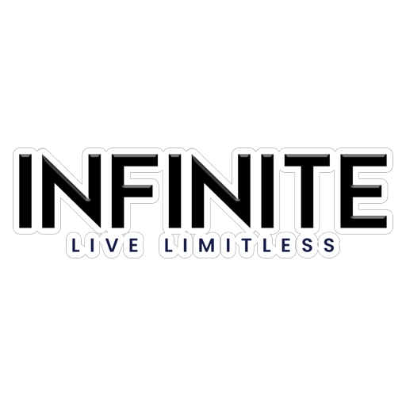

  

  # ✦ I N F I N I T E ✦
  ### **L I V E &nbsp; L I M I T L E S S**

  

    <strong>Global E-Commerce &bull; Organic Health & Wellness &bull; Luxury Skincare &bull; International Affiliate Network</strong>
  

  

    
    
    
    
    
    
  

---

## 🌟 System Information

**INFINITE: Live Limitless** is a modern, enterprise-grade digital platform engineered for international commerce, wellness distribution, and global affiliate empowerment. The platform brings together premium organic superfoods, French-formulated luxury anti-aging skincare, and an international onboarding portal designed to support entrepreneurs and customers across multiple territories worldwide.

Built as a high-performance Single Page Application (SPA), the system delivers fluid client-side transitions and instantaneous interactivity while maintaining brand elegance, responsive design, and automated transactional communications.

### 💎 Key Platform Highlights

- **Public Brand & Product Showcases**:
  - Interactive hero presentation with dynamic product carousels and brand mission pillars.
  - Category-based product curation covering **Organic Barley**, **Wellness**, and **O'Lamour Luxury Skincare**.
  - Detailed product ingredient breakdowns, daily health regimens, and before/after transformation galleries.
  - Corporate legitimacy center showcasing executive governance and verified accreditation documents.

- **International World Plan & Community Portals**:
  - Multi-currency support accommodating global partners across **USD ($)**, **PHP (₱)**, and **PGK (Kina)**.
  - Interactive earnings simulator and distributor tier information.
  - Streamlined member registration module featuring transparent non-refundable terms, data privacy compliance, and self-service detail updates.
  - Multi-country community gateways serving 11 international regions.

- **Executive Administrative Console**:
  - Real-time operational dashboard with live system metrics, inquiries, and application pipelines.
  - Full product catalog manager with public visibility toggles and category sorting.
  - Customer inquiry response desk with direct email messaging capabilities.
  - Member onboarding and bank remittance proof verification center.
  - Role-based administrator account governance (RBAC) and security audit trail tracking.

- **Real-Time Synchronization & Automated Communications**:
  - Background live pulse mechanism keeping data synchronized without requiring manual page reloads.
  - Automated transactional notifications for registrations, status approvals with certificates, inquiry receipts, and scheduled daily product spotlights.

---

## 🛠️ Technology Stack

| Technology Layer | Framework / Library | Description |
| :--- | :--- | :--- |
| **Backend Engine** | [Laravel 11.x](https://laravel.com/) (PHP 8.2+) | Robust, secure PHP web framework handling routing, queues, transactional mail, and business logic. |
| **Frontend Framework** | [React 19.x](https://react.dev/) | Modern, declarative component architecture powering all public and administrative user interfaces. |
| **SPA Bridge** | [Inertia.js 2.0](https://inertiajs.com/) | Seamless monolith-to-SPA adapter eliminating redundant REST API layers while preserving single-page responsiveness. |
| **Build & Tooling** | [Vite 5.x](https://vitejs.dev/) | Next-generation frontend bundler with lightning-fast asset compilation and hot module reloading. |
| **Styling & Design** | [Tailwind CSS 3.4](https://tailwindcss.com/) | Utility-first responsive CSS framework implementing the custom INFINITE Dark Navy and Teal color palette. |
| **Icons & UI Assets** | [Lucide React](https://lucide.dev/) | High-consistency, modern icon set utilized across public widgets and administrative consoles. |
| **Typography** | Bebas Neue & Barlow | Signature geometric headline display and ultra-legible modern body fonts. |
| **Realtime Engine** | Pulse Polling & Web Audio | Synchronized data snapshotting with subtle synthetic sound cues. |

---

## 👥 Leadership & Founders

| **Primo Ecalne Jr.** | **Aera Claridad** |
| :---: | :---: |
| *Founder & Global Partner* | *Co-Founder & Global Partner* |
| 📍 Philippines &bull; 🌐 Global Distribution | 📍 Philippines &bull; 🌐 Global Distribution |

---

## 💻 System Developers

| **Jay-ar S. De Guzman** | **Reazel Keith Herbas** |
| :---: | :---: |
| *Backend Developer & System Integrator* | *Frontend Developer & UI/UX Designer* |
| 📍 Philippines | 📍 Philippines |

---

### **INFINITE &bull; LIVE LIMITLESS**
*Empowering Global Entrepreneurs Through Premium Skincare & Wellness*

[Official Website](https://www.infinite-limitless.com) &bull; [Registration Portal](https://www.infinite-limitless.com/registration) &bull; [World Plan](https://www.infinite-limitless.com/world-plan)

 

Copyright &copy; 2026 INFINITE. All rights reserved.

